# Harness architecture for this repository

The harness connects a task to a bounded working context, executable checks and
current evidence. The coding agent chooses edits; deterministic tools decide
whether those edits pass the repository's checks. OpenSpec and repository files
remain shared truth across agent products and human sessions (ADR-0003).

## Reference models and selected ideas

These are architectural adaptations, not claims that the upstream frameworks are
installed or that this small harness reproduces their complete capabilities.

| Reference | Observed model | Adaptation here | Boundary |
| --- | --- | --- | --- |
| [Aider](https://aider.chat/docs/usage/lint-test.html) | Edits feed lint/test results back into the coding loop | Targeted checks during editing; full gate before completion | No automatic error-fixing model loop |
| [SWE-agent](https://swe-agent.com/latest/usage/trajectories/) | Structured trajectories support inspecting an execution | Operational step events and log pointers | No recording of model thought traces/prompts |
| [OpenHands events](https://docs.openhands.dev/sdk/arch/events) and [persistence](https://docs.openhands.dev/sdk/guides/convo-persistence) | Append-only events alongside persisted state | `events.jsonl` plus atomic run summary with active step | Local observations, no distributed event bus |
| [LangGraph persistence](https://docs.langchain.com/oss/python/langgraph/persistence) | Thread checkpoints and longer-lived stores have different responsibilities | Run artifacts for execution; OpenSpec/ADR/PROGRESS for durable decisions | No second workflow database |

The local design also uses a feedback-control loop: select the intended outcome,
change the code, observe checks, correct failures, and confirm against the same
inputs. Its state-machine boundary prevents an old observation from certifying
new code. This is our design synthesis, not an upstream framework feature claim.

## Components

```mermaid
flowchart TD
  A[OpenSpec task + policy map] --> B[Bounded context packet]
  B --> C[Agent implements one task]
  C --> D[Targeted checks]
  D --> C
  C --> E[Full verify --change]
  E --> F[Step events + logs + input digest]
  F --> G[Read-only status and handoff]
  G -->|failed or stale| C
  G -->|current pass + required UI evidence| H[Review, update tasks/progress, commit]
  H --> A
```

1. **Policy and intent:** AGENTS, golden rules, architecture, proposal/specs/tasks.
   The first unchecked numbered task is selected, ignoring fenced examples.
2. **Context:** `task.mjs context CHANGE` emits pointers, a proposal excerpt,
   selected task and at most three bounded history excerpts. The full sources
   remain available; truncation never changes the underlying task contract.
3. **Execution:** the existing Bash gate controls ordering, timeout and locking.
   Targeted tests accelerate feedback but cannot mark a task done.
4. **Observations:** the run records task identity, start/end input fingerprints,
   completed steps, active step and operational events. Errors remain observable.
5. **Recovery and learning:** status rechecks current inputs; handoff reports
   failures and evidence paths. Decisions/gaps go into shared files and recurring
   gaps become executable tests. It does not execute the previous session's actions.

## State and completion

A run moves `running → passed | failed | interrupted`. Input/task changes during
execution force failure. A hard kill may leave `running` and an active step;
inspect it, then invoke a new verification. A historical `passed` run can become
**stale** when current inputs differ; stale is a derived assessment and does not
rewrite history. Committing the same working-tree bytes does not stale evidence.

Gate success establishes only the checks actually run. Browser flows, accessibility
and task-specific scenarios still need their required evidence before completing
the task. A handoff report does not set checkboxes, approve scope, or authorize
external side effects. A generic run has no bound task and says so explicitly.

## Fingerprint boundary

SHA-256 (`sha256-v2`) covers paths, file kind, executable bits and the Git blob id
of Git-visible tracked and untracked files; ignored build/runtime artifacts are
excluded. Content is hashed as Git would store it (`git hash-object`, applying
`core.autocrlf`/attributes), and on Windows kind/exec bits come from the index, so a
CRLF Windows checkout and its LF WSL gate clone agree (ADR-0004). Symlinks hash
their link target string, not files outside the checkout. Deleted files disappear
from the digest; renames change it. This handles staged and unstaged content alike.

Explicit administrative exclusions are `.engram/`, `harness/runs/`, `harness/progress/`,
`harness/PROGRESS.md` and per-change `tasks.md`, `proposal.md`, `handoff.md`.
For a bound run, the selected task ID/title and proposal text (except its status
line) have an additional contract digest. Specs remain regular hashed inputs.
This permits checkboxes/progress/handoff updates after verification without
making code evidence stale, while a changed task contract needs another run.

This is a local consistency check, not a hermetic build or tamper-proof attestation.
It does not attest ignored `.env` values, installed node_modules, external APIs,
or an edit-and-restore occurring entirely between snapshots. A snapshot failure
or unavailable Git data cannot certify freshness. Artifact directories are ignored
but can be shared through existing CI uploads; durable decisions belong in Git.

## Evaluation and adoption

Regression fixtures cover task selection, malformed tasks, context limits,
tracked/untracked edits, deletions, renames, mode changes, commit stability,
contract changes, interruption, stale/failed/legacy evidence and CLI handoffs.
The harness suite is the repeatable evaluation set; bugs found in operation should
add a failing fixture before repair. Run time is recorded per step, not assumed.

Existing changes do not need migration. Use `--change` for task work; generic CI
may keep `./harness/verify.sh`. Adopt browser evidence contracts or isolated
worktrees separately when a concrete task needs them. Automatic CI remains paused.
